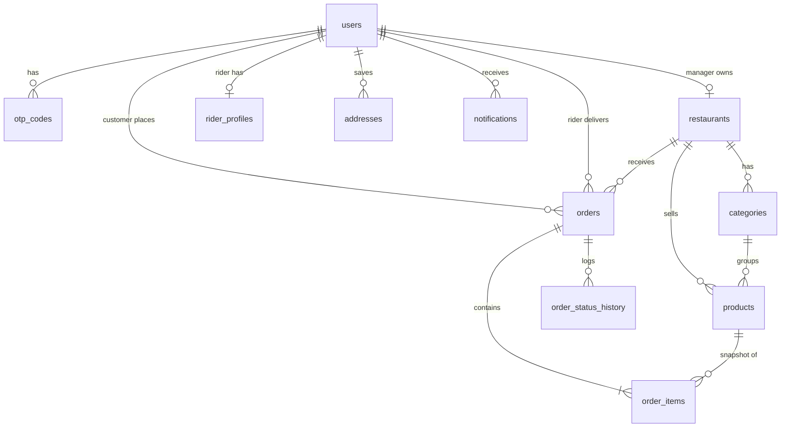

# Database

PostgreSQL 13+. Changes are made with numbered files in `migrations/`; never edit one that has already run, add the next number instead.

```bash
npm run migrate          # apply pending migrations
npm run migrate:status   # list applied / pending
npm run db:reset         # DEV ONLY: wipe everything
npm run seed:admin       # first admin from .env (the only seeded row)
```

## What the database enforces itself
- Emails are lowercase, phones are digit-only with optional `+`, prices and fees are never negative, `total = subtotal + delivery_fee`.
- Only a `manager` can own a restaurant, only a `rider` can have a rider profile or be assigned a delivery, only a `customer` can place an order.
- Restaurant names and category names are unique (case-insensitive).
- `orders.updated_at` updates automatically.
- Every order status change is written to `order_status_history`, and every approve/reject/suspend to `review_log`. No app code is needed for either.
- `SELECT purge_stale_data();` removes expired OTPs, old read notifications, never-verified accounts (7 days) and cancels unpaid orders after 24 h. The server runs it hourly.

## Added in migration 003
- `platform_settings`: commission %, delivery radius (km) and an "accept orders" switch, edited by the admin.
- `payments`: ledger of every charge attempt and refund (reference, amount, status).
- `restaurants.latitude/longitude` and `orders.delivery_lat/delivery_lng` power the delivery-radius check.
- `orders.commission_amount` and `restaurant_payout` are fixed at payment time using the commission % in force then, so changing the setting never rewrites history.
- `rider_locations`: latest position per rider, cleared after a day of silence. Customers only see it while their order is `ready` or `picked_up`.

## Relationships

Order items copy the product name and price at purchase time, so later menu edits never change past orders.
